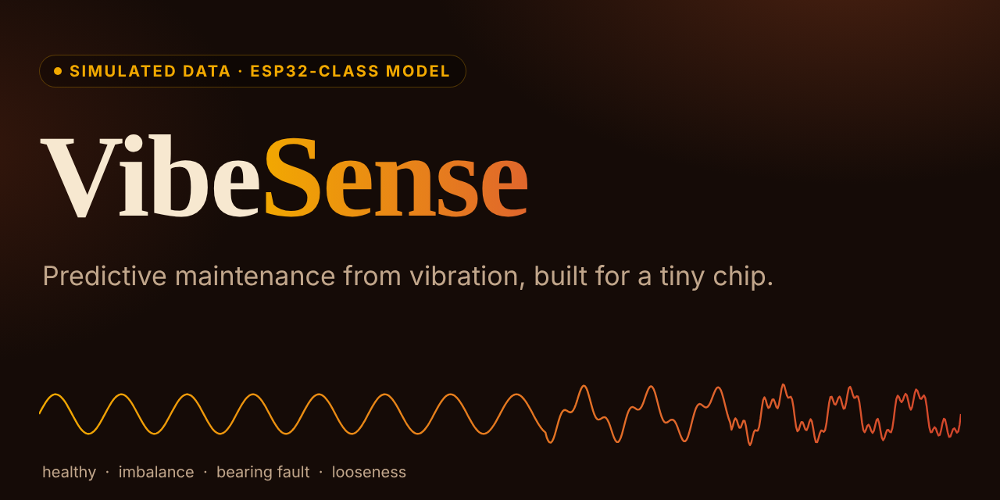
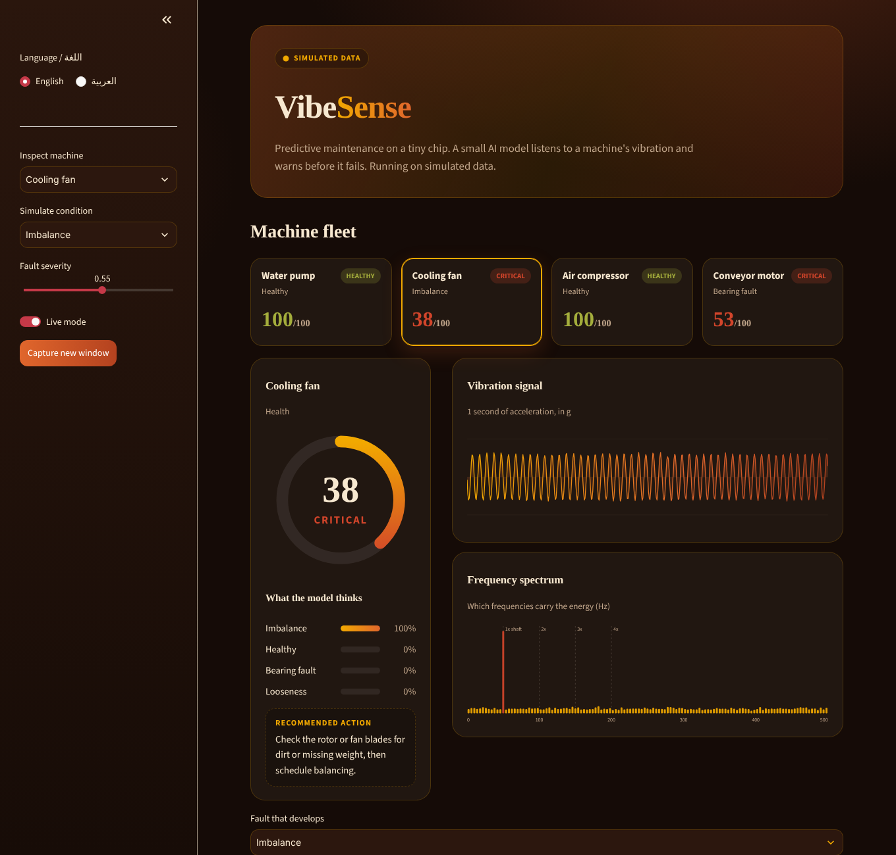

<p align="center"></p>

# VibeSense

Predictive maintenance from vibration, built for a tiny chip (ESP32 class).
A small ML model looks at one second of machine vibration, tells you **what** is wrong and **how bad** it is, and a dashboard shows when maintenance is due.

> **Honest status.** Everything runs on **simulated** vibration. The simulator is built from simple physics (shaft frequency, harmonics, bearing impacts). The model has **not** been validated on a real machine. Recording real vibration is the next milestone.



## What is inside
| Part | What it does |
|---|---|
| `vibesense/simulator.py` | Generates 1 s accelerometer windows (1024 samples) for 4 conditions: healthy, imbalance, bearing fault, looseness |
| `vibesense/features.py` | 11 cheap features: RMS, peak, crest factor, kurtosis, 6 FFT band energies, peak frequency |
| `vibesense/train.py` | Trains a classifier (which fault) and a regressor (how severe) |
| `vibesense/export_c.py` | Trains a **tiny** forest (10 trees, depth 6, about 22 KB) and exports it as a C header |
| `firmware/wokwi/` | C core + Arduino sketch + wiring for an ESP32 simulated in [Wokwi](https://wokwi.com) |
| `app.py` | Streamlit dashboard, English / Arabic, live fleet view and a 60 day ageing time-lapse |
| `tests/` | Unit tests, plus a test that the **C code gives the same answers as Python** |

## Run the dashboard
```bash
pip install -r requirements.txt
python -m vibesense.train          # models for the dashboard
python -m vibesense.export_c       # tiny model + C header for the ESP32
streamlit run app.py
pytest                             # tests (the C parity test needs gcc)
```

## Run the ESP32 simulation (Wokwi)
1. Create a new ESP32 project on wokwi.com.
2. Copy the files in `firmware/wokwi/` into it: `sketch.ino`, `diagram.json`, `vibesense_core.h`, `model.h`.
3. Press play. Open the serial monitor.
4. The **button** cycles the machine condition, the **potentiometer** sets fault severity, and the **LEDs** show health (green, yellow, red).

The "machine" is simulated in software inside the sketch, so no accelerometer is needed. To use a real one, replace the `vs_make_window` call with a read from an MPU6050 at 1024 samples per second.

## Results (simulated test windows)
| Model | Condition accuracy | Severity error (MAE) |
|---|---|---|
| Dashboard model (60 trees) | about 97% | about 0.05 |
| Embedded model (10 trees, about 22 KB) | about 95% | about 0.06 |

Exact numbers are in `models/metrics.json` and `models/embedded_metrics.json`. Mild faults are sometimes confused with healthy: the simulator randomises sensor gain and noise so the classes overlap.

**Checked:** the C implementation matches the Python one to about 1e-6 on features and probabilities, and classifies windows from its own C simulator at about 99% (`tests/test_firmware.py`).
**Not checked yet:** timing and memory on a physical ESP32, and any real machine data.

## Roadmap
- [ ] Record real vibration (MPU6050 on a fan, or a phone accelerometer) and compare it with the simulator
- [ ] Validate on a public bearing dataset such as CWRU
- [ ] Run on a physical ESP32 and measure inference time and memory
- [ ] Add a calibration step per machine

## License
MIT
